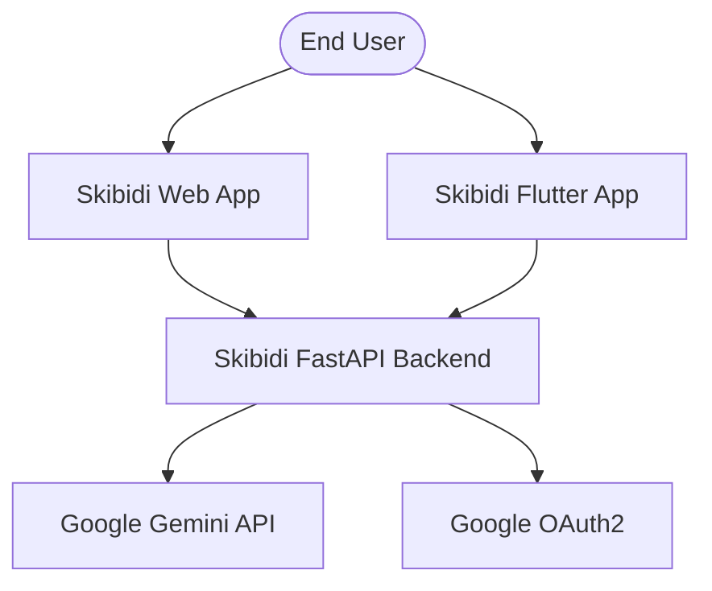
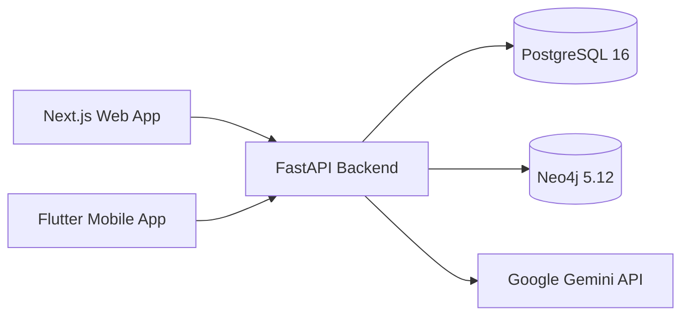
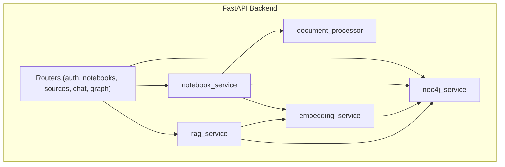
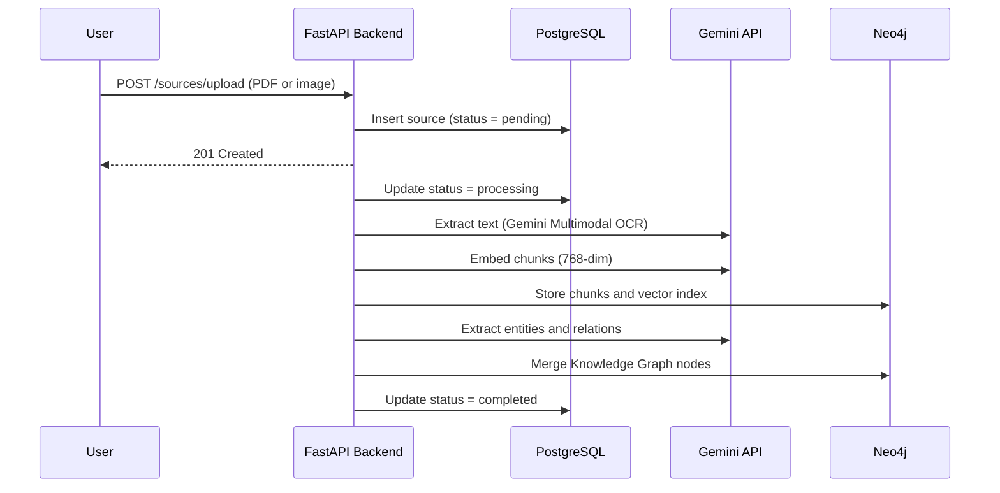
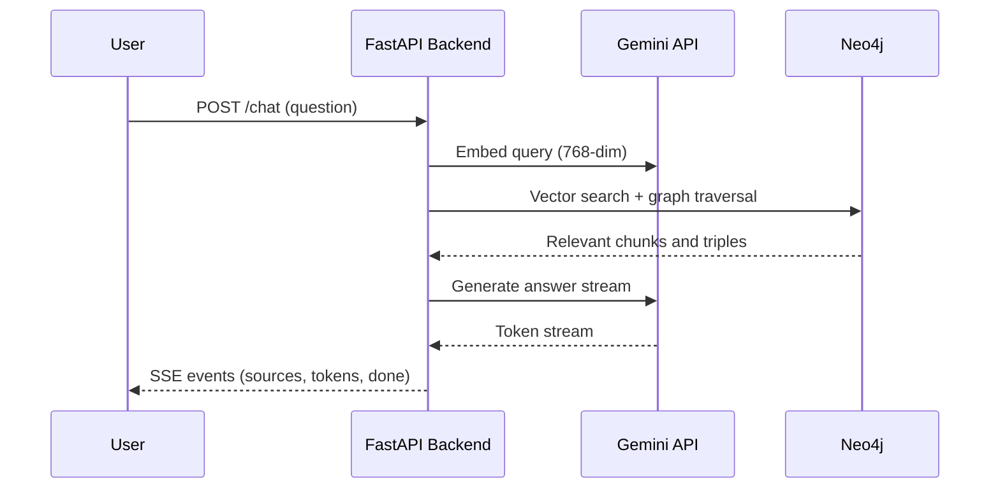

# Architecture document

**System:** Skibidi Document Summarization and Q&A Platform  
**Version:** 0.2.0  
**Status:** Accepted  
**Audience:** Engineers joining the system  
**Voice:** STE100  

---

## Purpose

Skibidi extracts text from PDFs, images, and web pages, builds a Neo4j Knowledge Graph and vector index, and answers user questions through streaming GraphRAG chat. Students, researchers, and developers use the Next.js web app or the Flutter mobile app to organize sources into notebooks and query them.

---

## System context

**In scope:** User authentication, notebook and source management, document OCR and text extraction, vector embedding and Knowledge Graph generation, streaming GraphRAG Q&A, and 2D graph visualization.  
**Out of scope:** Multi-tenant enterprise SSO, real-time collaborative editing, and billing management.

---

## Containers

| Container | Tech | Role |
|---|---|---|
| Web Frontend | Next.js 15, React 19, TailwindCSS 3 | Provides notebook workspace, upload progress UI, streaming chat, and 2D Knowledge Graph view |
| Mobile App | Flutter, Signals, GetIt, Dio | Provides mobile notebook management and Q&A client |
| Backend API | Python 3.11+, FastAPI, Uvicorn | Exposes REST and SSE endpoints, orchestrates OCR, embeddings, and GraphRAG |
| Relational Store | PostgreSQL 16 (SQLAlchemy async) | Stores `users`, `notebooks`, `sources`, and `chat_messages` |
| Graph & Vector Store | Neo4j 5.12 + APOC | Stores document chunks, 768-dimension vector index, and Knowledge Graph entities |

---

## Components

### API Endpoints

| Method | Path | Router | Purpose |
|---|---|---|---|
| `POST` | `/auth/register` | `auth.py` | Register a local user account |
| `POST` | `/auth/login` | `auth.py` | Authenticate with email and password |
| `POST` | `/auth/google` | `auth.py` | Authenticate with a Google ID token |
| `GET` | `/auth/me` | `auth.py` | Return the authenticated user profile |
| `GET` | `/api/notebooks` | `notebooks.py` | List notebooks for the current user |
| `POST` | `/api/notebooks` | `notebooks.py` | Create a new notebook |
| `DELETE` | `/api/notebooks/{notebook_id}` | `notebooks.py` | Delete a notebook and related data |
| `GET` | `/api/notebooks/{notebook_id}/sources` | `sources.py` | List sources in a notebook |
| `POST` | `/api/notebooks/{notebook_id}/sources/upload` | `sources.py` | Upload a PDF or image file |
| `POST` | `/api/notebooks/{notebook_id}/sources/url` | `sources.py` | Add a web URL source |
| `DELETE` | `/api/notebooks/{notebook_id}/sources/{source_id}` | `sources.py` | Delete a source and its graph chunks |
| `GET` | `/api/notebooks/{notebook_id}/sources/{source_id}/file` | `sources.py` | Download or preview the source file |
| `GET` | `/api/notebooks/{notebook_id}/chat` | `chat.py` | Retrieve chat history |
| `POST` | `/api/notebooks/{notebook_id}/chat` | `chat.py` | Stream a GraphRAG response via SSE |
| `GET` | `/api/notebooks/{notebook_id}/graph` | `graph.py` | Return Knowledge Graph nodes and edges |
| `GET` | `/api/health` | `main.py` | Return backend health status |

### Data Model (PostgreSQL)

| Table | Key Columns | Purpose |
|---|---|---|
| `users` | `id`, `email`, `google_id` | Stores registered accounts |
| `notebooks` | `id`, `user_id`, `title`, `description` | Groups sources and chat threads |
| `sources` | `id`, `notebook_id`, `title`, `source_type`, `status`, `chunk_count` | Tracks uploaded files and URLs |
| `chat_messages` | `id`, `notebook_id`, `role`, `content`, `sources_used` | Persists conversation history |

---

## Key sequences

### 1. Document Upload and Background Processing

### 2. GraphRAG Streaming Q&A

---

## Deployment

1. Start PostgreSQL 16 and Neo4j 5.12 containers from `backend/docker-compose.yml`.
2. Configure environment variables in `backend/.env` and `frontend/.env.local`.
3. Start the FastAPI server with Uvicorn on port `8000`.
4. Start the Next.js server on port `3000`.

